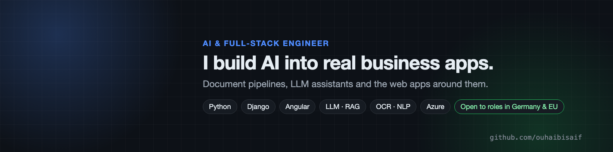
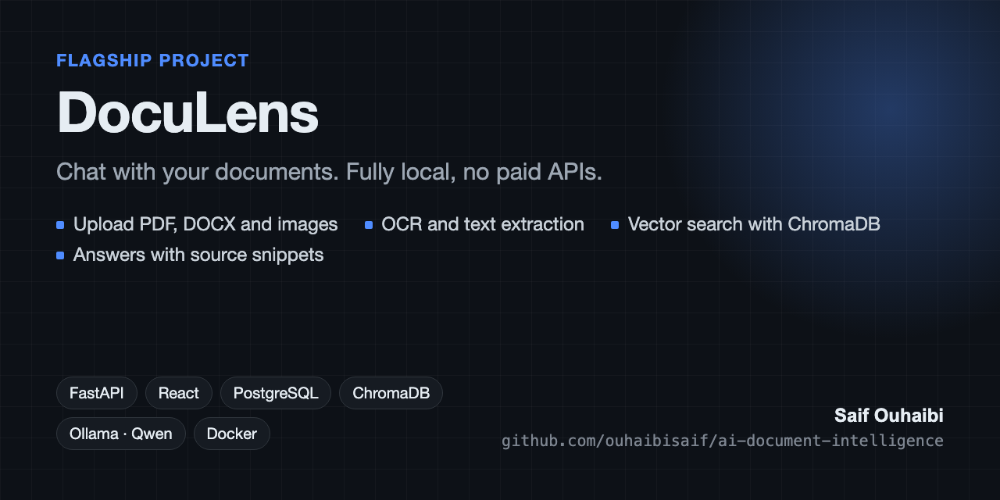
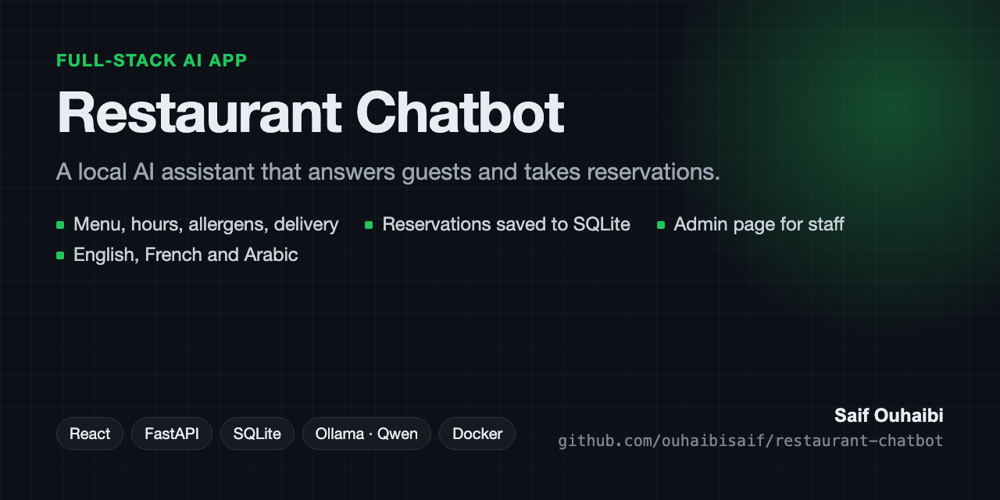

  

<h1 align="center">Hi, I'm Saif 👋</h1>
<h3 align="center">AI & Full-Stack Engineer · I build the AI part <i>and</i> the app around it</h3>

  
  
  

---

- 🏭 **In production:** an OCR → NLP → CNN pipeline at **STEG**, Tunisia's national electricity and gas operator, that turns scanned PDFs, Word files and images into structured data with no manual step. The CNN runs at **92% accuracy**.
- 🛠️ **Now:** business apps at **SIGMA** with document extraction and an LLM assistant (client code is private).
- 🎓 **Teaching:** an AI course covering Python, ML, NLP and generative AI.
- 🌍 **Languages:** Arabic · French · English · German (B2). *Ich suche eine Stelle als AI/Software Engineer in Deutschland oder der EU.*

## 🚀 Featured projects

<table>
  <tr>
    <td width="50%" valign="top">
      
       <b><a href="https://github.com/ouhaibisaif/ai-document-intelligence">DocuLens</a></b> 
      Local-first RAG over PDFs, DOCX and scans: OCR, ChromaDB vector search, chat with sources. No paid APIs.
    </td>
    <td width="50%" valign="top">
      
       <b><a href="https://github.com/ouhaibisaif/restaurant-chatbot">Restaurant Chatbot</a></b> 
      EN/FR/AR assistant with reservations and prompt-injection guardrails written in code.
    </td>
  </tr>
</table>

## 🧰 Tech stack

**AI / ML** 

**Backend** 

**Frontend** 

**Cloud & tools** 

---

<i>A model nobody can use isn't a product. I ship the whole thing.</i>

